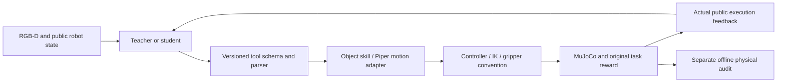

# Piper adaptation: what has to agree

This guide is a migration contract, **not a one-command robot runtime**. It deliberately does not vendor upstream code or CAD.

## Architecture

Privileged task/object/contact state may be used by the offline audit and explicit perturbation injection, never as a hidden planner/teacher observation. Ground-truth diagnosis scripts are not teacher-generated training demonstrations.

## Required invariants

1. **Controller/gripper units:** distinguish normalized robosuite input from direct position actuator commands. Do not apply normalization twice or assume one controller fix applies to another fork. Test open/close and model reset before model-in-loop evaluation.
2. **Pose semantics:** name table/base/world frames and quaternion order. When the chosen wrist orientation changes, recompute TCP from the intended physical fingertip/contact point using that same orientation. `geometry.tcp_for_contact_goal` illustrates this contract without robot-specific constants.
3. **Tool semantics:** `move` arrived is a pose statement, not evidence that an object is held. Preserve actual return status and explicit failure stages. A trained model emitting `motion_mode` does not imply the evaluation executor supports it.
4. **Collision geometry:** the historical56×76.5×22.5mm finger-body box produced contacts19–26mm from verified visual CAD in selected cases. Replacing it with a CAD convex hull reduced some false contact, but hulls fill concavities and real fingertip contact remains. Do not use inflated force/friction or ignore contact to force success.
5. **Payload:** the old juice asset compiled to0.138g. Selected higher-mass diagnostic candidates behaved differently. Production later used a user-selected70–140g random range. This is an engineering assumption, not hardware mass calibration or full-range robustness proof.
6. **Perception:** robot self points, multiple semantic instances and occluded visible surfaces require separate checks. Robust point-cloud statistics can be stronger/cheaper than another observation. Do not merge views that refer to different instances.
7. **Restore:** compiled model, integration state, controller caches, RGB and history must agree. A drawer slide is articulated, not a free object. Validate that a fault really changes the relevant condition before asking a teacher to recover.
8. **Dataset export:** preserve native assistant text/tool calls, image positions and loss masks. The historical SFT loader required an explicit content-preserving conversion; tool-call fields cannot simply be assumed to survive every trainer.

## Budgets and scope

Historical official task YAML turn budgets: apple25, push20, red25, can20, drawer15, tray10, shell25; retries3, output2048. Report historical overrides rather than silently reclassifying old trajectories. Motion speed, randomization, prompts, parser, camera and model revision also belong in the protocol. Piper control/CAD, camera setup, teacher provider and the mass range are adaptations; do not call the result an identical Panda benchmark reproduction.

## Use the original runtime

Obtain [upstream Guava](https://github.com/hdacnw/guava-release) and its author fork according to its current access/license terms. The historical pinned commit is in `NOTICE.md`; current upstream may differ. This repository supplies original offline audit primitives, data and documented fixes, not all historical environment-specific monkeypatches. There is no claim that copying these primitives alone runs the simulation.
